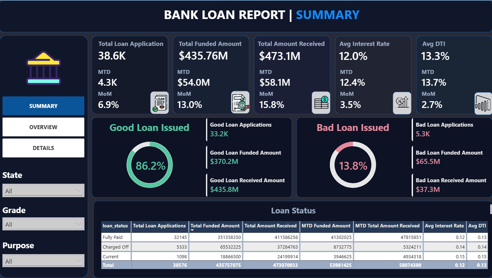
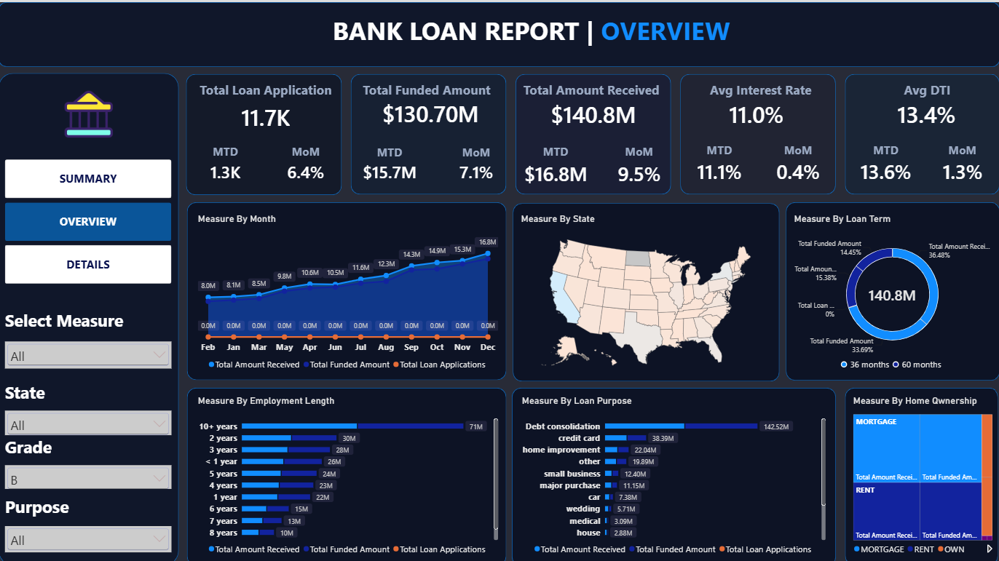
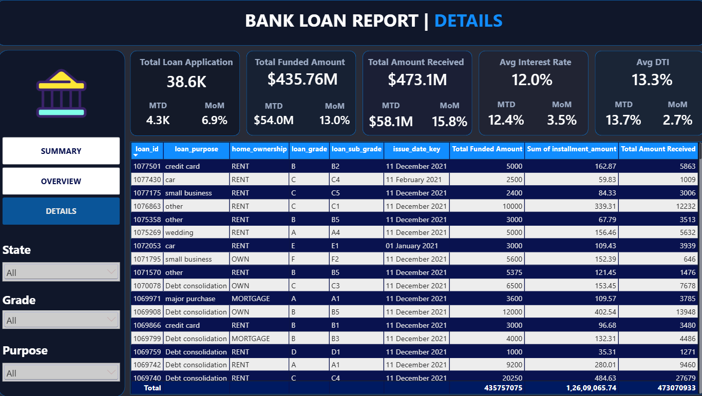

# BANK LOAN REPORT & RISK ANALYSIS DASHBOARD


---


## ◈ PROJECT OVERVIEW

The **Bank Loan Report & Risk Analysis Dashboard** is an interactive Business Intelligence project developed using Microsoft Power BI to analyze banking loan operations, loan applications, funded amounts, repayments, and portfolio performance.

The primary objective of this project is to transform raw financial loan data into meaningful business insights that help stakeholders monitor lending activities, evaluate loan quality, and understand repayment performance.

The dashboard provides a consolidated view of key financial metrics through interactive visualizations, KPI cards, analytical reports, and dynamic filters.


## ⌖ BUSINESS OBJECTIVES

The project focuses on answering important business questions related to banking and loan operations:

- How many loan applications have been received?
- What is the total amount funded by the bank?
- How much loan amount has been received back?
- What percentage of loans are classified as Good Loans and Bad Loans?
- Which loan purposes contribute the most to loan applications?
- How do loan applications vary across different time periods?
- Which borrower segments contribute to higher loan exposure?
- How do interest rates and Debt-to-Income ratios vary across the loan portfolio?


## ▦ KEY PERFORMANCE INDICATORS (KPIs)

The dashboard tracks the following key business metrics:

| KPI | Business Definition |
|---|---|
| Total Loan Applications | Measures the overall volume of loan applications. |
| Total Funded Amount | Measures the total capital disbursed by the bank. |
| Total Amount Received | Tracks the amount of loan repayments received. |
| Average Interest Rate | Measures the average interest rate across loans. |
| Average DTI | Evaluates borrowers' debt obligations relative to their income. |
| Good Loan % | Measures the proportion of loans classified as good. |
| Bad Loan % | Measures the proportion of loans classified as bad. |
| Good Loan Applications | Counts applications classified as good loans. |
| Bad Loan Applications | Counts applications classified as bad loans. |
| Bad Loan Funded Amount | Tracks the amount funded under bad loan accounts. |
| Bad Loan Received Amount | Tracks repayments received from bad loan accounts. |


## ▥ DASHBOARD MODULES


### 01. Loan Summary Dashboard

Provides a high-level summary of the bank's lending operations and overall loan portfolio.

**Key Analysis:**
- Total loan applications, funded amount, and received amount.
- Monthly loan application trends.
- Good Loan vs. Bad Loan distribution.
- Loan distribution by purpose and borrower characteristics.
- Loan portfolio performance across different categories.





### 02. Loan Overview Dashboard

Focuses on evaluating the quality and repayment performance of the loan portfolio.

**Key Analysis:**
- Good Loan and Bad Loan classification.
- Loan status distribution.
- Funded amount and received amount comparison.
- Analysis of loan repayment performance.
- Identification of potentially higher-risk loan segments.




### 03. Loan Details Dashboard

Focuses on evaluating the Overall Details of the loan portfolio.

**Key Analysis:**
- Overall Details Table Including :
  1. loan_id
  2. loan_purpose
  3. home_ownership
  4. loan_grade
  5. loan_sub_grade
  6. issue_date_key
  7. Total Funded Amount
  8. Sum of Installment Amount
  9. Total Amount Received




## ƒ DATA ANALYSIS & DAX MEASURES

DAX (Data Analysis Expressions) was used to develop calculated measures for business performance monitoring and dynamic reporting.

**Major Analytical Measures:**

- Total Loan Applications
- Total Funded Amount
- Total Amount Received
- Average Interest Rate
- Average Debt-to-Income Ratio (DTI)
- Good Loan Applications
- Bad Loan Applications
- Good Loan Percentage
- Bad Loan Percentage
- Good Loan Funded Amount
- Bad Loan Funded Amount
- Good Loan Received Amount
- Bad Loan Received Amount

These measures enable dynamic calculations and respond to dashboard filters and slicers.


## ⌘ DATA MODELLING

A **Star Schema data model** was implemented to organize the loan dataset into structured fact and dimension tables.

The model separates transactional loan information from descriptive borrower, loan, and date attributes.

**Data Model Components:**

| Table | Purpose |
|---|---|
| Fact Loan | Stores loan-related transactional information and numerical measures. |
| Dim Borrower | Contains borrower-related descriptive attributes. |
| Dim Loan | Contains loan classification and descriptive information. |
| Dim Date | Supports time-based analysis and date filtering. |

**Benefits of Star Schema:**
- Improves data organization.
- Simplifies analytical queries.
- Establishes meaningful relationships between tables.
- Supports efficient filtering and reporting.
- Improves maintainability of the data model.

## ⚙ TECHNOLOGY STACK

| Technology | Application |
|---|---|
| Microsoft SQL Server | Query Analysis |
| Microsoft Power BI | Dashboard development and data visualization |
| Power Query | Data cleaning and transformation |
| DAX | Calculated measures and business KPIs |
| Data Modelling | Star Schema design and table relationships |
| Microsoft Excel / CSV | Source dataset |

## ⟳ PROJECT WORKFLOW

The project followed a structured data analytics workflow:

**01 — Data Collection**

Imported the raw financial loan dataset into Power BI.

**02 — Data Cleaning & Transformation**

Examined the dataset and performed necessary data cleaning and transformations using Power Query.

**03 — Data Modelling**

Designed a Star Schema with fact and dimension tables and established relationships between them.

**04 — DAX Development**

Created calculated measures to evaluate loan performance and business KPIs.

**05 — Dashboard Development**

Designed interactive dashboards using KPI cards, charts, tables, and slicers.

**06 — Business Analysis**

Analyzed lending trends, loan quality, repayment performance, and borrower-related patterns.

## ▧ DASHBOARD PREVIEW

### Summary Dashboard


### Loan Performance Analysis


## ↗ BUSINESS VALUE & KEY TAKEAWAYS

This project demonstrates how raw banking data can be transformed into an interactive Business Intelligence solution.

The dashboard enables stakeholders to:

- Monitor overall loan portfolio performance.
- Evaluate the distribution of good and bad loans.
- Track loan disbursement and repayment amounts.
- Analyze borrower and loan-related trends.
- Identify loan segments that may require further risk assessment.
- Support data-driven lending and portfolio monitoring decisions.

## ⌁ REPOSITORY STRUCTURE

```text
Bank-Loan-Report-Summary/
│
│
├── dashboard/
│   ├── BankingLoan_Dashboard.pbix
|
|
|
├── datasets/
│   ├── Dashboard_screenshots
│   └── domain_knowledge.docx
|   └── financial_loan_data.excel
|   └── financial_loan.csv
|   └── Loan_Analysis_Queries.docx
|   └── Terminologies_description_of_data.docx
|
│
├── scripts/
│   └── Insights_OverViewDashboard.sql
|   └── Insights_SummaryDashboard.sql 
│
└── README.md
```

## ◉ AUTHOR

**Anubhav Pathak**

Data Analyst | Aspiring Data Engineer

**Technical Interests:** Data Analytics | Business Intelligence | SQL | Python | Data Engineering

- GitHub: https://github.com/actionxbar-14
- LinkedIn: [Add LinkedIn Profile URL]

---

*This project was developed as part of my Data Analytics learning journey, focusing on practical business analysis, financial data interpretation, data modelling, and interactive dashboard development.*
